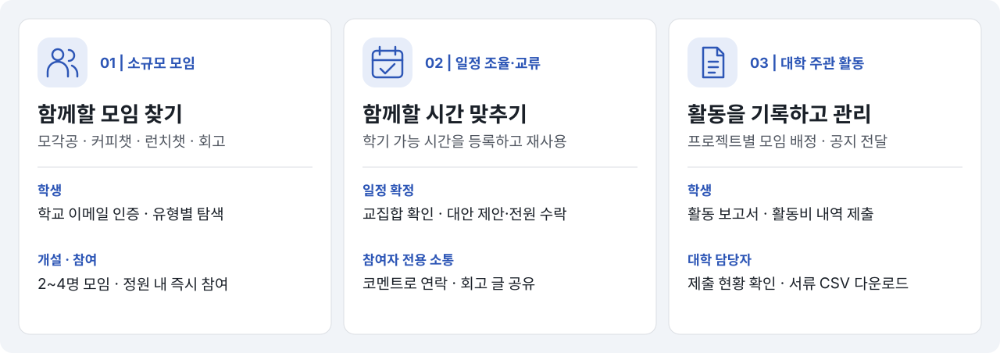
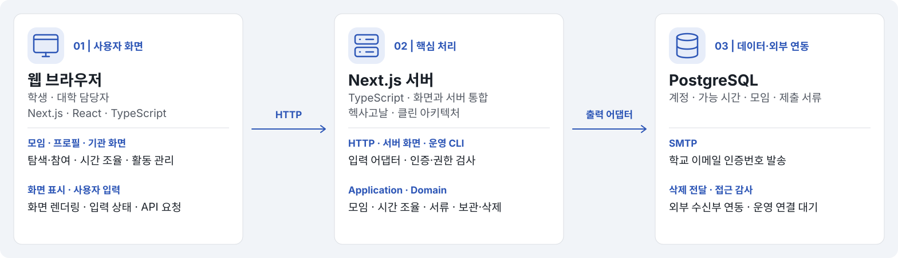

# 모잇 (Moit)

## 소개

같은 학교 학생이 관심 주제와 가능 시간에 맞춰 소규모 모임을 여는 모바일 웹. 운영 연결·출시 대기 항목은 [구현 계획](plan.md#남은-작업)에서 관리한다.



## 기술 스택

Next.js App Router·TypeScript·PostgreSQL·SMTP. 구조는 [구현 계획](plan.md)을 따른다.



## 시작하기

Node.js 버전은 [package.json](package.json)의 `engines`를 따른다. PostgreSQL을 준비하고 저장소 루트에서 실행한다.

```sh
npm ci
cp frontend/.env.example frontend/.env.local
# DB 연결·32자 이상 AUTH_SECRET·APP_ORIGIN 설정
npm run db:migrate
npm run dev
```

환경 변수의 항목·설명은 [설정 예시](frontend/.env.example)를 따른다. 개발 메일을 파일로 받으려면 `TEST_MAIL_DIR`을 설정한다. 실제 가입은 [출시 조건](spec.md#출시-조건)을 충족하기 전까지 차단된다.

## 사용 방법

### 로컬 로그인 데모

별도 로컬 PostgreSQL DB 이름을 `_demo`로 끝나도록 만들고 `frontend/.env.local`에 해당 `DATABASE_URL`, `APP_ORIGIN=http://127.0.0.1:3000`, 32자 이상 `AUTH_SECRET`, `DEMO_LOGIN=true`를 설정한다.

```sh
npm run demo:setup
WATCHPACK_POLLING=true npm run dev -- --hostname 127.0.0.1 --webpack
```

로그인 화면에서 학생 또는 대학 담당자 합성 계정을 선택하고 인증번호를 받는다. 화면의 번호로 인증하면 해당 유형의 화면으로 이동한다. 데모의 인증 방식·제한은 [요구사항](spec.md#로컬-로그인-데모)을 따른다. 운영 배포는 [운영 안내](docs/operations.md)를 따른다.

### 학생

1. `/`에서 로그인하면 학생 홈에서 참여 모임과 가능 시간 요약을 확인한다. `/profile`에서 학기 가능 시간을 등록한다. 시간표 이미지 업로드는 고정 예시를 채우는 목업이며 직접 수정·검토 후 저장한다.
2. `/meetings`에서 모임을 찾거나 `/meetings/new`에서 개설한다. 참여·개설 후 모임 관리에서 일정·조율·코멘트를 확인한다. [회고 모임](spec.md#모임-분류회고-모임)은 참여자 전용 회고 게시판에서 글을 공유한다.
3. 배정된 대학 주관 모임도 `/meetings/manage`에서 선택해 공지·활동일·장소를 확인하고 활동일부터 보고서·사용 내역서를 제출한다. 서류별 CSV 다운로드를 제공한다.
4. 프로필에서 차단 해제·로그아웃·탈퇴, `/privacy`에서 운영 고지를 확인한다.

### 대학 담당자

담당자 지정은 [운영 안내](docs/operations.md#계정-유형-관리)를 따른다. 인증 후 `/institutions`에서 [합성 통계 시연](spec.md#기관-시연)을 확인한다.

`/institutions/meetings`에서 프로젝트 생성·선택 → 모임별 이름·학생 이메일 입력 → 일괄 등록 → 공지 게시·제출 현황·서류 확인 순서로 사용한다. 모임 삭제는 상세의 삭제 메뉴를 사용한다. 권한·제출·삭제·보관 조건은 [주관 모임 정책](spec.md#대학-주관-모임제출-서류)을 따른다.

### API

기본 경로는 `/api/v1`이다. 아래 경로는 기본 경로 기준이다. HTTP 경로·입력·응답은 [HTTP 어댑터](backend/adapters/http/api.ts)에서 확인한다.

- 변경 요청에 `Origin: APP_ORIGIN`·쿠키·`X-CSRF-Token`을 전달한다.
- `GET /auth/csrf`로 토큰을 받고 로그인 후 재발급한다.
- 조율 요청은 상세 ETag를 `If-Match`로 전달한다.
- 공개 설정은 `GET /configuration`에서 조회한다.

## 테스트

로컬 검사 명령은 [package.json](package.json)의 `scripts`, CI 실행 순서·DB 설정은 [워크플로](.github/workflows/ci.yml)를 따른다. push·PR 검사 결과는 GitHub Actions에서 확인한다.

## 관련 문서

[요구사항](spec.md) · [구현 계획](plan.md) · [디자인](docs/design.md) · [운영](docs/operations.md) · [작업 지침](AGENTS.md)
