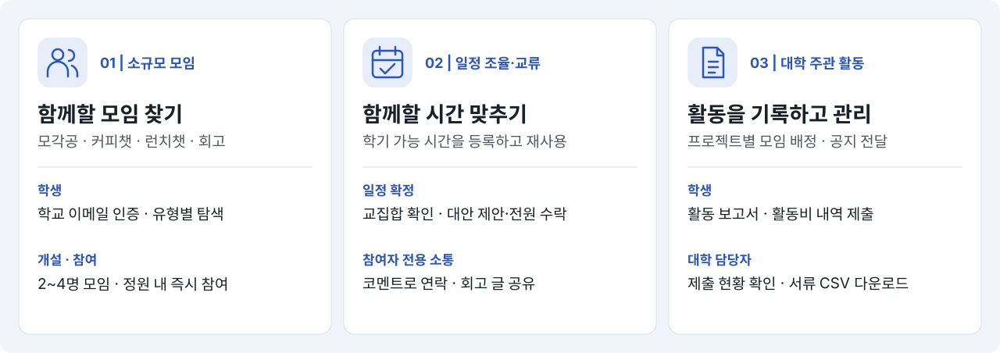
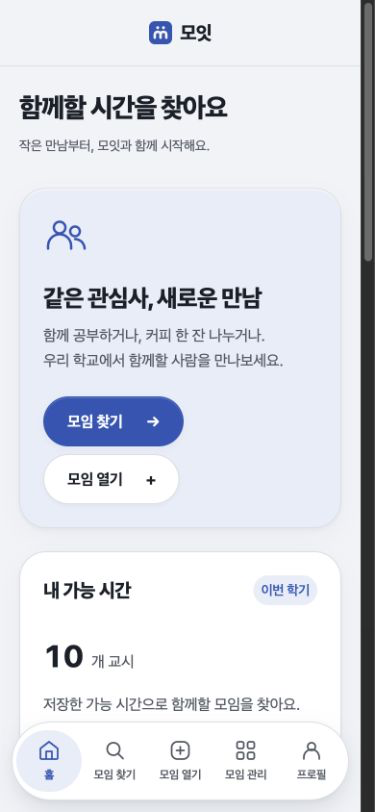
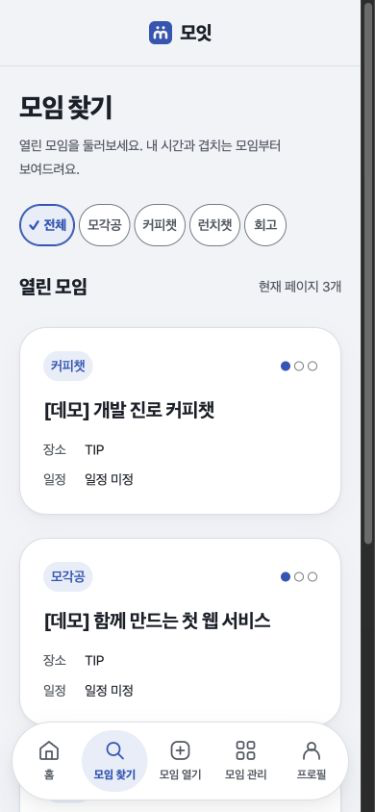
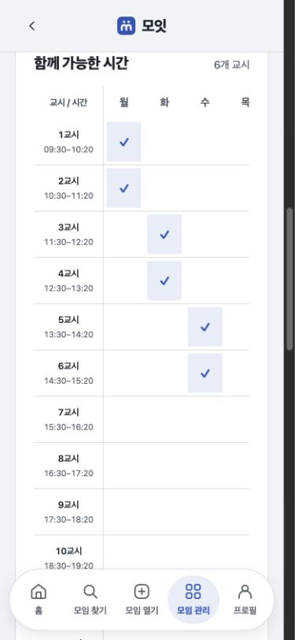
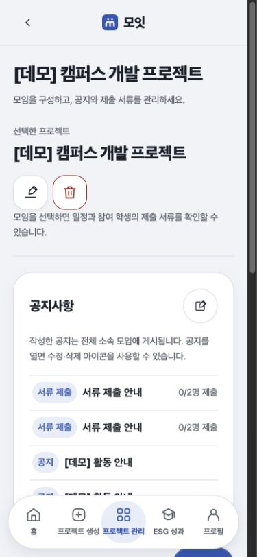
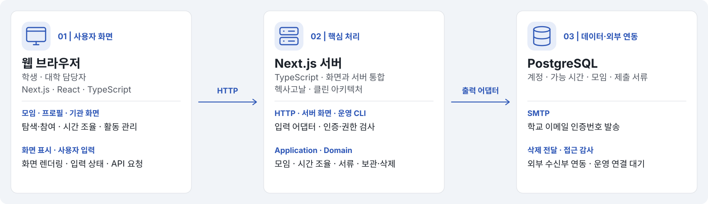

# 모잇 (Moit)

## 소개

같은 학교 학생이 관심 주제와 가능 시간에 맞춰 소규모 모임을 여는 모바일 웹. 운영 연결·출시 대기 항목은 [구현 계획](plan.md#남은-작업)에서 관리한다.



### 주요 화면

로컬 데모의 합성 계정·데이터를 모바일 뷰로 촬영했다. 이미지를 누르면 원본 크기로 볼 수 있다.

| 학생 홈 | 모임 찾기 | 함께 가능한 시간 | 대학 담당자 프로젝트 관리 |
| --- | --- | --- | --- |
| [](docs/assets/student-home.png) | [](docs/assets/meeting-discovery.png) | [](docs/assets/meeting-coordination.png) | [](docs/assets/institution-projects.png) |
| 가능 시간·참여 모임·배정된 대학 주관 활동을 확인한다. | 모각공·커피챗·런치챗·회고 모임을 찾아 참여한다. | 참여자 모두 가능한 교시를 확인하고 모임 시간을 조율한다. | 프로젝트별 소속 모임·공지와 제출 서류를 관리한다. |

## 기술 스택

Next.js App Router·TypeScript·PostgreSQL·SMTP. 구조는 [구현 계획](plan.md)을 따른다.



## 시작하기

Node.js 버전은 [package.json](package.json)의 `engines`를 따른다. PostgreSQL을 준비하고 저장소 루트에서 실행한다.

```sh
npm ci
cp frontend/.env.example frontend/.env.local
# DB 연결·32자 이상 AUTH_SECRET·APP_ORIGIN 설정
npm run db:migrate
npm run dev
```

개발 서버는 `http://localhost:3000`에서 확인한다.

환경 변수의 항목·설명은 [설정 예시](frontend/.env.example)를 따른다. 개발 메일을 파일로 받으려면 `TEST_MAIL_DIR`을 설정한다. 실제 가입은 [출시 조건](spec.md#출시-조건)을 충족하기 전까지 차단된다.

## 사용 방법

### 로컬 로그인 데모

별도 로컬 PostgreSQL DB 이름을 `_demo`로 끝나도록 만들고 `frontend/.env.local`에 해당 `DATABASE_URL`, `APP_ORIGIN=http://127.0.0.1:3000`, 32자 이상 `AUTH_SECRET`, `DEMO_LOGIN=true`를 설정한다.

```sh
npm run demo:setup
WATCHPACK_POLLING=true npm run dev -- --hostname 127.0.0.1 --webpack
```

로그인 화면에서 학생 또는 대학 담당자 합성 계정을 선택하고 인증번호를 받는다. 화면의 번호로 인증하면 해당 유형의 화면으로 이동한다. 데모의 인증 방식·제한은 [요구사항](spec.md#로컬-로그인-데모)을 따른다. 운영 배포는 [운영 안내](docs/operations.md)를 따른다.

`demo:setup`은 가능 시간과 자율 모임, 템플릿별 주관 프로젝트·공지·제출 예시를 함께 준비한다. 학생 1로 모임 찾기·참여 모임·회고·서류 제출을, 담당자로 프로젝트 관리와 제출 완료·일부 제출·미제출 상태를 확인할 수 있다. 데이터는 모두 합성이며 ESG 수치는 별도의 고정 시나리오다.

재실행하면 데모 학기·서비스 기간을 연장하고 누락되거나 만료된 예시를 추가한다. 기존 가능 시간·활동 내용은 덮어쓰지 않는다. 예시는 `[데모]` 모임 주제·프로젝트 제목으로 구분하므로 제목을 변경하거나 삭제한 뒤 재실행하면 해당 기본 예시가 다시 생성된다.

### 학생

학교 이메일로 로그인한 뒤 프로필에서 가능 시간을 등록하고, 모임 찾기 또는 모임 열기로 시작한다. 참여 이후에는 모임 관리에서 활동한다.

화면 경로·유형별 이용 기능은 [학생 내비게이션](docs/specs/student.md#내비게이션프로필), 이미지 업로드 예시는 [시간표·이미지 불러오기](docs/specs/student.md#시간표이미지-불러오기), 배정된 활동의 제출 방법은 [서류 제출·열람](docs/specs/institution.md#서류-제출열람)을 참고한다.

### 대학 담당자

[운영자 지정](docs/operations.md#계정-유형-관리) 후 다시 로그인한다. 프로젝트 생성 → 프로젝트 관리에서 모임 등록 → 공지 작성 → 제출 자료 확인 순서로 이용한다.

메뉴·경로는 [기관 내비게이션](docs/specs/institution.md#내비게이션프로필), 배정·공지·서류 조건은 [주관 모임 정책](docs/specs/institution.md#대학-주관-모임제출-서류), 화면의 버튼 위치는 [디자인 기준](docs/design.md#대학-주관-모임)을 참고한다.

### API

기본 경로는 `/api/v1`이며 [RESTful API 기준](spec.md#restful-api)을 따른다. 아래 경로는 기본 경로 기준이다. HTTP 경로·입력·응답은 [HTTP 어댑터](backend/adapters/http/api.ts)에서 확인한다.

- 변경 요청에 `Origin: APP_ORIGIN`·쿠키·`X-CSRF-Token`을 전달한다.
- `GET /auth/csrf`로 토큰을 받고 로그인 후 재발급한다.
- 조율 요청은 상세 ETag를 `If-Match`로 전달한다.
- 공개 설정은 `GET /configuration`에서 조회한다.

실행 중인 서버의 [Scalar 문서](http://localhost:3000/docs)에서 API 경로를 확인한다.

Bruno에서 [`backend/bruno`](backend/bruno) 폴더를 열고 `Local` 환경을 선택한다. 로그인 순서·역할별 실행과 변수 설정은 [Bruno 사용 안내](backend/bruno/README.md)를 따른다.

## 테스트

검증 범위와 판정 기준은 [구현 계획](plan.md#검증-전략)을 따른다.

별도 테스트 DB를 `DATABASE_URL`로 지정하고 마이그레이션한 뒤 실행한다. 테스트의 DB 변경이 개발·운영 자료에 영향을 주지 않도록 분리한다.

```sh
npm run typecheck
npm test
npm run build
```

명령 정의는 [package.json](package.json)의 `scripts`, CI 실행 순서·DB 설정은 [워크플로](.github/workflows/ci.yml)를 따른다. CI는 main push·PR에서 테스트와 타입 검사를 포함한 빌드를 실행한다. 검사 결과는 GitHub Actions에서 확인한다.

## 관련 문서

| 문서 | 내용 |
| --- | --- |
| [공통 요구사항](spec.md) | 범위·인증·개인정보·출시 조건 |
| [학생 요구사항](docs/specs/student.md) | 학생 기능·시간 조율·AI 작성 지원 요구 |
| [기관 요구사항](docs/specs/institution.md) | 담당자 기능·주관 모임·서류 정책 |
| [구현 계획](plan.md) | 현재 구조·구현 방향·검증 전략·남은 작업 |
| [디자인 기준](docs/design.md) | 화면 배치·상태·접근성 |
| [운영 안내](docs/operations.md) | 서버 설치·계정 유형·삭제·복구 |
| [Bruno 사용 안내](backend/bruno/README.md) | API 수동 호출·인증·요청 변수 설정 |
| [작업 지침](AGENTS.md) | 문서와 코드 변경 원칙 |
